# VALIDACIÓN DE SOBREVIVIENTE PRO

Generado el 10/11/2026 02:16 · reglamento 1.1.0 · datos del 01/01/2022 al 31/10/2026.

## Resumen en una frase

**Ninguna estrategia pasó todas las pruebas.** Eso es un resultado válido y valioso: el sistema evita arriesgar dinero en algo que no demostró ventaja.

| Estrategia | ¿Pasa? | Operaciones fuera de muestra | Expectativa (R) | Factor de ganancia | Caída p95 Monte Carlo | Le gana al azar | Prueba final |
|---|---|---|---|---|---|---|---|
| E1 Ruptura de tendencia | ❌ No | 485 | -0.086 | 0.80 | 59.0 % | 69 % | -0.150R en 61 op. |
| E2 Retroceso en tendencia | ❌ No | 888 | -0.231 | 0.63 | 94.0 % | 79 % | -0.225R en 126 op. |
| E3 Reversión en rango | ❌ No | 971 | -0.115 | 0.56 | 50.5 % | 0 % | -0.112R en 130 op. |
| E4 Surfista (memes) | ❌ No | 104 | -0.152 | 0.70 | 17.2 % | 83 % | -0.024R en 9 op. |
| E5 Francotirador (cortos) | ❌ No | 37 | -0.204 | 0.54 | 14.7 % | 5 % | +0.350R en 5 op. |

**Cómo leer esta tabla:**
- *Expectativa (R)*: lo que deja en promedio cada operación, en unidades de riesgo. +0.10R significa que, si arriesgas 1 peso por operación, en promedio te quedan 10 centavos ya con comisiones.
- *Factor de ganancia*: lo ganado entre lo perdido. 1.0 = empate; se pide 1.3 o más.
- *Caída p95*: en el peor 5 % de 10,000 simulaciones, cuánto llegaría a caer el capital.
- *Le gana al azar*: a qué porcentaje de 1,000 carteras con entradas al azar (mismas salidas) supera. Se pide 90 %.
- *Prueba final*: los últimos 6 meses, que nadie tocó hasta el final.

## Cómo se hizo (para que confíes en los números)

- **Periodo:** enero de 2022 a octubre de 2026. Incluye el mercado bajista de 2022, el lateral de 2023 y los alcistas posteriores.
- **Walk-forward:** 14 ventanas. En cada una se eligen los parámetros con 12 meses y se prueban en los 3 meses siguientes, que la estrategia no vio. **Solo se reportan esos 3 meses de prueba.**
- **Prueba final intocable:** 01/05/2026 a 31/10/2026. Se abrió una sola vez, al final.
- **Costos reales:** comisión de Spot 0.10 % por lado; Futuros 0.05 % por lado; deslizamiento de 0.05 % (grandes), 0.10 % (medianas) y 0.30 % (memes); funding real en Futuros.
- **Sin ver el futuro:** cada señal usa solo velas cerradas y se ejecuta en la apertura de la vela siguiente. Hay pruebas automáticas que lo garantizan.
- **El mismo motor de riesgo que en vivo:** cada operación pasó por las mismas reglas (calor, posiciones, topes, régimen de BTC, volatilidad, costos, mínimos de Binance).
- **Capital de prueba:** 10,000 USDT para medir la ventaja sin que estorben los mínimos de Binance; además se repite con tus 46.18 USDT reales.
- **Sesgo de supervivencia:** se usaron 456 monedas que estuvieron en el universo en algún momento, incluidas 111 que Binance ya deslistó (por ejemplo LUNA o FTT). No se pudieron incluir pares que Binance borró por completo de su API.
- **Futuros:** 170 perpetuos con velas y funding de los archivos oficiales de Binance.
- **Memes:** 27 memes de la lista actual de `memes.json`. Ojo: la lista se armó hoy, así que tiene algo de sesgo (incluye memes que sabemos que se hicieron famosas).

## E1 — Ruptura de tendencia: ❌ NO PASA

Ronda de ajustes 1 de 3 · 18 combinaciones de parámetros probadas · parámetros finales: `{'donchian_n': 55, 'stop_atr': 3.0, 'chandelier_atr': 3.0}`

**Compuertas:**

- ✅ 485 operaciones fuera de muestra (mínimo 100)
- ❌ factor de ganancia 0.80 (mínimo 1.3)
- ❌ expectativa -0.086R (mínimo +0.1R)
- ❌ 14 % de ventanas positivas (mínimo 60 %; contando solo las 14 ventanas con operaciones: 14 %)
- ❌ caída p95 de Monte Carlo 59.0 % (máximo 25 %)
- ❌ le gana al 68.6 % de las entradas al azar (mínimo 90.00 %)
- ❌ prueba final: 61 operaciones, expectativa -0.150R, factor 0.67
- ❌ robustez ±20 %: peor expectativa -0.190R

**Fuera de muestra (los 3 meses de prueba de cada ventana, unidos):**

| Número | Valor | Qué significa |
|---|---|---|
| Operaciones | 485 | cuántas veces entró |
| % ganadoras | 37.7 % | de cada 100 operaciones, cuántas ganaron |
| Ganancia promedio | +0.88R | lo que deja una ganadora en promedio |
| Pérdida promedio | -0.67R | lo que quita una perdedora en promedio |
| Expectativa | -0.086R | promedio por operación, ya con costos |
| Factor de ganancia | 0.80 | ganado ÷ perdido |
| Peor racha | 21 pérdidas seguidas | prepárate mentalmente para esto |
| Ventanas positivas | 14 % | en cuántos trimestres ganó |
| Rendimiento (capital de prueba) | -31.8 % | con 1 % de riesgo por operación |
| Caída máxima (capital de prueba) | 37.7 % | lo más que bajó desde un máximo |
| Comisiones | 6 % de la ganancia bruta | lo que se llevó Binance |

**Monte Carlo (10,000 simulaciones):** rendimiento entre -56.6 % y -2.9 % (90 % de los casos; mediana -36.4 %). Caída máxima típica 42.5 %, en el peor 5 % 59.0 %. Probabilidad de tocar −15 % (el freno total): 99.8 %. Racha perdedora típica 11, en el peor 5 % 17.

**Contra el azar:** con entradas al azar (mismas salidas, mismos filtros) la expectativa típica fue -0.106R; el 10 % mejor llegó a -0.052R. La estrategia le gana al 69 % de ellas.

**Contra comprar y aguantar BTC:** en el mismo periodo fuera de muestra BTC hizo +361.9 % con una caída de 50.1 %; la estrategia -31.8 % con caída de 37.7 %. En la prueba final BTC hizo +1.5 %.

**Por régimen de BTC al entrar:**

| Régimen | Operaciones | Expectativa | Factor de ganancia |
|---|---|---|---|
| ALCISTA | 223 | -0.115R | 0.72 |
| LATERAL | 262 | -0.061R | 0.86 |

**Prueba final intocable:** 61 operaciones, expectativa -0.150R, factor 0.67, rendimiento -4.8 %.

**Con tus 46.18 USDT reales:** de 3815 señales que pasaron los demás filtros, se habrían ejecutado 225 y **1890 se habrían saltado por falta de capital**.
Para no saltarse la mitad de esas, harían falta unos **87 USDT**; para no saltarse 3 de cada 4, unos 151 USDT.

**Robustez:** al mover donchian_n, stop_atr ±20 %, la peor expectativa fue -0.190R (negativa en todos los casos: no hay una zona de parámetros que funcione).

**Ventanas de walk-forward:**

| Prueba | Parámetros elegidos | Operaciones | Suma de R |
|---|---|---|---|
| 2023-01-01 a 2023-04-01 | `{'donchian_n': 20, 'stop_atr': 3.0, 'chandelier_atr': 3.0}` | 56 | -4.04 |
| 2023-04-01 a 2023-07-01 | `{'donchian_n': 55, 'stop_atr': 3.0, 'chandelier_atr': 3.0}` | 24 | -5.39 |
| 2023-07-01 a 2023-10-01 | `{'donchian_n': 55, 'stop_atr': 3.0, 'chandelier_atr': 3.0}` | 23 | -3.63 |
| 2023-10-01 a 2024-01-01 | `{'donchian_n': 55, 'stop_atr': 3.0, 'chandelier_atr': 4.0}` | 46 | +26.56 |
| 2024-01-01 a 2024-04-01 | `{'donchian_n': 55, 'stop_atr': 3.0, 'chandelier_atr': 3.0}` | 66 | -5.43 |
| 2024-04-01 a 2024-07-01 | `{'donchian_n': 55, 'stop_atr': 3.0, 'chandelier_atr': 4.0}` | 37 | -7.18 |
| 2024-07-01 a 2024-10-01 | `{'donchian_n': 55, 'stop_atr': 3.0, 'chandelier_atr': 3.0}` | 32 | -1.96 |
| 2024-10-01 a 2025-01-01 | `{'donchian_n': 55, 'stop_atr': 3.0, 'chandelier_atr': 3.0}` | 55 | -11.99 |
| 2025-01-01 a 2025-04-01 | `{'donchian_n': 20, 'stop_atr': 3.0, 'chandelier_atr': 4.0}` | 29 | -14.19 |
| 2025-04-01 a 2025-07-01 | `{'donchian_n': 20, 'stop_atr': 3.0, 'chandelier_atr': 4.0}` | 39 | -11.97 |
| 2025-07-01 a 2025-10-01 | `{'donchian_n': 20, 'stop_atr': 3.0, 'chandelier_atr': 4.0}` | 33 | +10.56 |
| 2025-10-01 a 2026-01-01 | `{'donchian_n': 20, 'stop_atr': 3.0, 'chandelier_atr': 4.0}` | 13 | -3.53 |
| 2026-01-01 a 2026-04-01 | `{'donchian_n': 20, 'stop_atr': 3.0, 'chandelier_atr': 3.0}` | 19 | -5.84 |
| 2026-04-01 a 2026-05-01 | `{'donchian_n': 20, 'stop_atr': 3.0, 'chandelier_atr': 3.0}` | 13 | -3.47 |

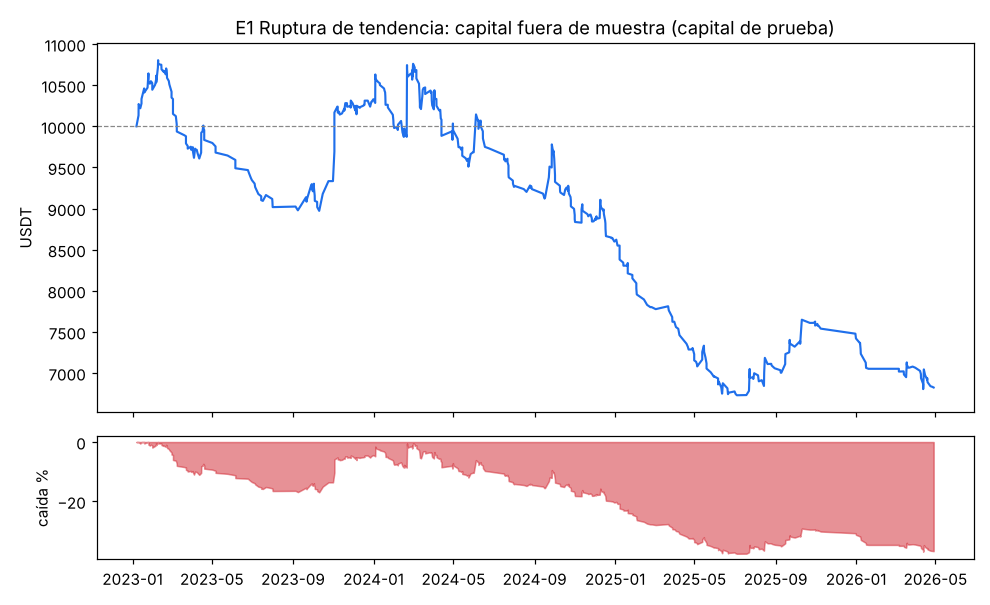
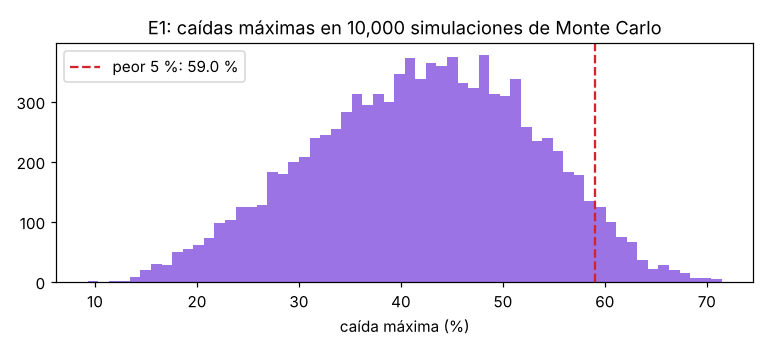
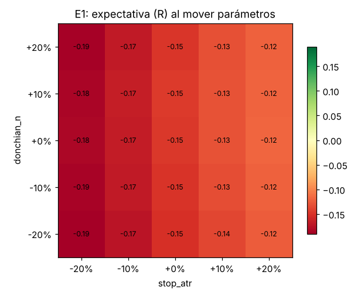

> Nota: Con el capital de prueba, el freno de −15 % se habría activado 4 vez/veces (2023-07-15, 2024-09-17, 2025-01-14, 2025-05-20). En el backtest se simuló que Ángelo daba el OK para seguir midiendo.

## E2 — Retroceso en tendencia: ❌ NO PASA

Ronda de ajustes 1 de 3 · 9 combinaciones de parámetros probadas · parámetros finales: `{'rsi_reset': 40, 'stop_atr': 2.0, 'chandelier_atr': 3.0}`

**Compuertas:**

- ✅ 888 operaciones fuera de muestra (mínimo 100)
- ❌ factor de ganancia 0.63 (mínimo 1.3)
- ❌ expectativa -0.231R (mínimo +0.1R)
- ❌ 14 % de ventanas positivas (mínimo 60 %; contando solo las 14 ventanas con operaciones: 14 %)
- ❌ caída p95 de Monte Carlo 94.0 % (máximo 25 %)
- ❌ le gana al 79.1 % de las entradas al azar (mínimo 90.00 %)
- ❌ prueba final: 126 operaciones, expectativa -0.225R, factor 0.63
- ❌ robustez ±20 %: peor expectativa -0.262R

**Fuera de muestra (los 3 meses de prueba de cada ventana, unidos):**

| Número | Valor | Qué significa |
|---|---|---|
| Operaciones | 888 | cuántas veces entró |
| % ganadoras | 44.7 % | de cada 100 operaciones, cuántas ganaron |
| Ganancia promedio | +0.86R | lo que deja una ganadora en promedio |
| Pérdida promedio | -1.12R | lo que quita una perdedora en promedio |
| Expectativa | -0.231R | promedio por operación, ya con costos |
| Factor de ganancia | 0.63 | ganado ÷ perdido |
| Peor racha | 13 pérdidas seguidas | prepárate mentalmente para esto |
| Ventanas positivas | 14 % | en cuántos trimestres ganó |
| Rendimiento (capital de prueba) | -81.0 % | con 1 % de riesgo por operación |
| Caída máxima (capital de prueba) | 82.9 % | lo más que bajó desde un máximo |
| Comisiones | 15 % de la ganancia bruta | lo que se llevó Binance |

**Monte Carlo (10,000 simulaciones):** rendimiento entre -93.7 % y -77.0 % (90 % de los casos; mediana -88.1 %). Caída máxima típica 88.9 %, en el peor 5 % 94.0 %. Probabilidad de tocar −15 % (el freno total): 100.0 %. Racha perdedora típica 10, en el peor 5 % 15.

**Contra el azar:** con entradas al azar (mismas salidas, mismos filtros) la expectativa típica fue -0.273R; el 10 % mejor llegó a -0.205R. La estrategia le gana al 79 % de ellas.

**Contra comprar y aguantar BTC:** en el mismo periodo fuera de muestra BTC hizo +361.9 % con una caída de 50.1 %; la estrategia -81.0 % con caída de 82.9 %. En la prueba final BTC hizo +1.5 %.

**Por régimen de BTC al entrar:**

| Régimen | Operaciones | Expectativa | Factor de ganancia |
|---|---|---|---|
| ALCISTA | 432 | -0.190R | 0.70 |
| LATERAL | 456 | -0.270R | 0.56 |

**Prueba final intocable:** 126 operaciones, expectativa -0.225R, factor 0.63, rendimiento -15.8 %.

**Con tus 46.18 USDT reales:** de 2499 señales que pasaron los demás filtros, se habrían ejecutado 588 y **691 se habrían saltado por falta de capital**.
Para no saltarse la mitad de esas, harían falta unos **33 USDT**; para no saltarse 3 de cada 4, unos 51 USDT.

**Robustez:** al mover rsi_reset, stop_atr ±20 %, la peor expectativa fue -0.262R (negativa en todos los casos: no hay una zona de parámetros que funcione).

**Ventanas de walk-forward:**

| Prueba | Parámetros elegidos | Operaciones | Suma de R |
|---|---|---|---|
| 2023-01-01 a 2023-04-01 | `{'rsi_reset': 40, 'stop_atr': 2.5, 'chandelier_atr': 3.0}` | 113 | -19.20 |
| 2023-04-01 a 2023-07-01 | `{'rsi_reset': 35, 'stop_atr': 1.5, 'chandelier_atr': 3.0}` | 15 | -13.80 |
| 2023-07-01 a 2023-10-01 | `{'rsi_reset': 35, 'stop_atr': 1.5, 'chandelier_atr': 3.0}` | 20 | -9.45 |
| 2023-10-01 a 2024-01-01 | `{'rsi_reset': 35, 'stop_atr': 2.5, 'chandelier_atr': 3.0}` | 51 | -6.70 |
| 2024-01-01 a 2024-04-01 | `{'rsi_reset': 35, 'stop_atr': 2.0, 'chandelier_atr': 3.0}` | 81 | +7.17 |
| 2024-04-01 a 2024-07-01 | `{'rsi_reset': 35, 'stop_atr': 2.5, 'chandelier_atr': 3.0}` | 48 | -12.10 |
| 2024-07-01 a 2024-10-01 | `{'rsi_reset': 35, 'stop_atr': 2.5, 'chandelier_atr': 3.0}` | 38 | -12.08 |
| 2024-10-01 a 2025-01-01 | `{'rsi_reset': 35, 'stop_atr': 1.5, 'chandelier_atr': 3.0}` | 50 | -33.02 |
| 2025-01-01 a 2025-04-01 | `{'rsi_reset': 35, 'stop_atr': 2.5, 'chandelier_atr': 3.0}` | 22 | -9.72 |
| 2025-04-01 a 2025-07-01 | `{'rsi_reset': 45, 'stop_atr': 2.5, 'chandelier_atr': 3.0}` | 158 | -26.51 |
| 2025-07-01 a 2025-10-01 | `{'rsi_reset': 45, 'stop_atr': 2.0, 'chandelier_atr': 3.0}` | 171 | -38.54 |
| 2025-10-01 a 2026-01-01 | `{'rsi_reset': 45, 'stop_atr': 2.5, 'chandelier_atr': 3.0}` | 50 | -12.38 |
| 2026-01-01 a 2026-04-01 | `{'rsi_reset': 45, 'stop_atr': 2.0, 'chandelier_atr': 3.0}` | 50 | -21.44 |
| 2026-04-01 a 2026-05-01 | `{'rsi_reset': 40, 'stop_atr': 2.0, 'chandelier_atr': 3.0}` | 21 | +2.57 |

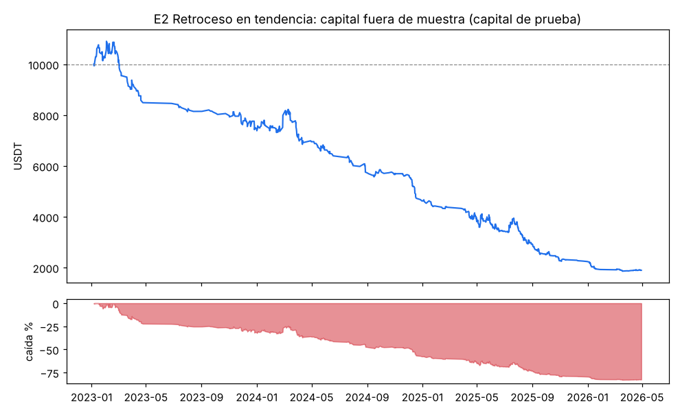
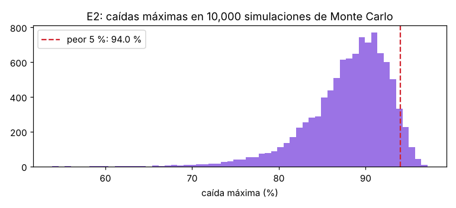
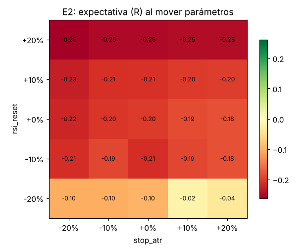

> Nota: Con el capital de prueba, el freno de −15 % se habría activado 12 vez/veces (2023-03-23, 2023-11-01, 2024-04-04, 2024-08-22, 2024-12-14, 2025-02-18, 2025-05-05, 2025-06-16, 2025-08-05, 2025-09-03, 2025-10-28, 2026-01-16). En el backtest se simuló que Ángelo daba el OK para seguir midiendo.

## E3 — Reversión en rango: ❌ NO PASA

Ronda de ajustes 1 de 3 · 18 combinaciones de parámetros probadas · parámetros finales: `{'rsi2_max': 15, 'stop_atr': 2.5, 'salida_media': 10}`

**Compuertas:**

- ✅ 971 operaciones fuera de muestra (mínimo 100)
- ❌ factor de ganancia 0.56 (mínimo 1.3)
- ❌ expectativa -0.115R (mínimo +0.1R)
- ❌ 7 % de ventanas positivas (mínimo 60 %; contando solo las 14 ventanas con operaciones: 7 %)
- ❌ caída p95 de Monte Carlo 50.5 % (máximo 25 %)
- ❌ le gana al 0.0 % de las entradas al azar (mínimo 90.00 %)
- ❌ prueba final: 130 operaciones, expectativa -0.112R, factor 0.62
- ❌ robustez ±20 %: peor expectativa -0.225R

**Fuera de muestra (los 3 meses de prueba de cada ventana, unidos):**

| Número | Valor | Qué significa |
|---|---|---|
| Operaciones | 971 | cuántas veces entró |
| % ganadoras | 52.4 % | de cada 100 operaciones, cuántas ganaron |
| Ganancia promedio | +0.28R | lo que deja una ganadora en promedio |
| Pérdida promedio | -0.55R | lo que quita una perdedora en promedio |
| Expectativa | -0.115R | promedio por operación, ya con costos |
| Factor de ganancia | 0.56 | ganado ÷ perdido |
| Peor racha | 13 pérdidas seguidas | prepárate mentalmente para esto |
| Ventanas positivas | 7 % | en cuántos trimestres ganó |
| Rendimiento (capital de prueba) | -40.7 % | con 1 % de riesgo por operación |
| Caída máxima (capital de prueba) | 41.1 % | lo más que bajó desde un máximo |
| Comisiones | 20 % de la ganancia bruta | lo que se llevó Binance |

**Monte Carlo (10,000 simulaciones):** rendimiento entre -50.3 % y -34.5 % (90 % de los casos; mediana -42.9 %). Caída máxima típica 43.4 %, en el peor 5 % 50.5 %. Probabilidad de tocar −15 % (el freno total): 100.0 %. Racha perdedora típica 8, en el peor 5 % 12.

**Contra el azar:** con entradas al azar (mismas salidas, mismos filtros) la expectativa típica fue -0.067R; el 10 % mejor llegó a -0.051R. La estrategia le gana al 0 % de ellas.

**Contra comprar y aguantar BTC:** en el mismo periodo fuera de muestra BTC hizo +361.9 % con una caída de 50.1 %; la estrategia -40.7 % con caída de 41.1 %. En la prueba final BTC hizo +1.5 %.

**Por régimen de BTC al entrar:**

| Régimen | Operaciones | Expectativa | Factor de ganancia |
|---|---|---|---|
| ALCISTA | 324 | -0.051R | 0.77 |
| LATERAL | 647 | -0.147R | 0.48 |

**Prueba final intocable:** 130 operaciones, expectativa -0.112R, factor 0.62, rendimiento -7.1 %.

**Con tus 46.18 USDT reales:** de 4741 señales que pasaron los demás filtros, se habrían ejecutado 223 y **3353 se habrían saltado por falta de capital**.
Para no saltarse la mitad de esas, harían falta unos **94 USDT**; para no saltarse 3 de cada 4, unos 138 USDT.

**Robustez:** al mover rsi2_max, stop_atr ±20 %, la peor expectativa fue -0.225R (negativa en todos los casos: no hay una zona de parámetros que funcione).

**Ventanas de walk-forward:**

| Prueba | Parámetros elegidos | Operaciones | Suma de R |
|---|---|---|---|
| 2023-01-01 a 2023-04-01 | `{'rsi2_max': 10, 'stop_atr': 2.5, 'salida_media': 5}` | 56 | -7.81 |
| 2023-04-01 a 2023-07-01 | `{'rsi2_max': 10, 'stop_atr': 2.5, 'salida_media': 5}` | 87 | -8.40 |
| 2023-07-01 a 2023-10-01 | `{'rsi2_max': 15, 'stop_atr': 2.5, 'salida_media': 5}` | 78 | -13.82 |
| 2023-10-01 a 2024-01-01 | `{'rsi2_max': 15, 'stop_atr': 2.5, 'salida_media': 5}` | 64 | +0.85 |
| 2024-01-01 a 2024-04-01 | `{'rsi2_max': 15, 'stop_atr': 2.5, 'salida_media': 10}` | 75 | -3.86 |
| 2024-04-01 a 2024-07-01 | `{'rsi2_max': 15, 'stop_atr': 2.5, 'salida_media': 5}` | 115 | -17.10 |
| 2024-07-01 a 2024-10-01 | `{'rsi2_max': 10, 'stop_atr': 2.5, 'salida_media': 5}` | 74 | -12.22 |
| 2024-10-01 a 2025-01-01 | `{'rsi2_max': 10, 'stop_atr': 2.5, 'salida_media': 5}` | 82 | -12.04 |
| 2025-01-01 a 2025-04-01 | `{'rsi2_max': 10, 'stop_atr': 2.5, 'salida_media': 5}` | 67 | -10.32 |
| 2025-04-01 a 2025-07-01 | `{'rsi2_max': 15, 'stop_atr': 2.5, 'salida_media': 5}` | 77 | -6.94 |
| 2025-07-01 a 2025-10-01 | `{'rsi2_max': 15, 'stop_atr': 2.5, 'salida_media': 5}` | 83 | -3.53 |
| 2025-10-01 a 2026-01-01 | `{'rsi2_max': 15, 'stop_atr': 2.5, 'salida_media': 5}` | 55 | -6.44 |
| 2026-01-01 a 2026-04-01 | `{'rsi2_max': 15, 'stop_atr': 2.5, 'salida_media': 5}` | 42 | -8.93 |
| 2026-04-01 a 2026-05-01 | `{'rsi2_max': 15, 'stop_atr': 2.5, 'salida_media': 10}` | 16 | -0.84 |

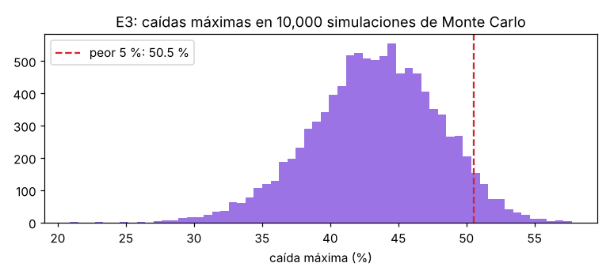
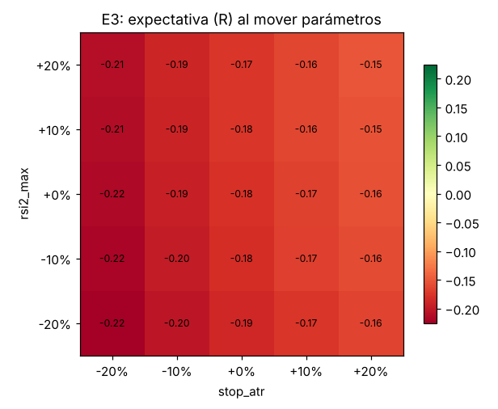

> Nota: Con el capital de prueba, el freno de −15 % se habría activado 3 vez/veces (2024-01-23, 2024-08-01, 2025-10-26). En el backtest se simuló que Ángelo daba el OK para seguir midiendo.

## E4 — Surfista (memes): ❌ NO PASA

Ronda de ajustes 1 de 3 · 18 combinaciones de parámetros probadas · parámetros finales: `{'vol_mult': 3.0, 'respiro_pct': 3.0, 'stop_atr': 2.0}`

**Compuertas:**

- ✅ 104 operaciones fuera de muestra (mínimo 100)
- ❌ factor de ganancia 0.70 (mínimo 1.3)
- ❌ expectativa -0.152R (mínimo +0.1R)
- ❌ 29 % de ventanas positivas (mínimo 60 %; contando solo las 14 ventanas con operaciones: 29 %)
- ✅ caída p95 de Monte Carlo 17.2 % (máximo 25 %)
- ❌ le gana al 82.7 % de las entradas al azar (mínimo 90.00 %)
- ❌ prueba final: 9 operaciones, expectativa -0.024R, factor 0.94
- ❌ robustez ±20 %: peor expectativa -0.248R

**Fuera de muestra (los 3 meses de prueba de cada ventana, unidos):**

| Número | Valor | Qué significa |
|---|---|---|
| Operaciones | 104 | cuántas veces entró |
| % ganadoras | 40.4 % | de cada 100 operaciones, cuántas ganaron |
| Ganancia promedio | +0.90R | lo que deja una ganadora en promedio |
| Pérdida promedio | -0.86R | lo que quita una perdedora en promedio |
| Expectativa | -0.152R | promedio por operación, ya con costos |
| Factor de ganancia | 0.70 | ganado ÷ perdido |
| Peor racha | 6 pérdidas seguidas | prepárate mentalmente para esto |
| Ventanas positivas | 29 % | en cuántos trimestres ganó |
| Rendimiento (capital de prueba) | -5.0 % | con 1 % de riesgo por operación |
| Caída máxima (capital de prueba) | 6.2 % | lo más que bajó desde un máximo |
| Comisiones | 7 % de la ganancia bruta | lo que se llevó Binance |

**Monte Carlo (10,000 simulaciones):** rendimiento entre -16.1 % y +2.1 % (90 % de los casos; mediana -8.0 %). Caída máxima típica 10.4 %, en el peor 5 % 17.2 %. Probabilidad de tocar −15 % (el freno total): 13.5 %. Racha perdedora típica 7, en el peor 5 % 12.

**Contra el azar:** con entradas al azar (mismas salidas, mismos filtros) la expectativa típica fue -0.282R; el 10 % mejor llegó a -0.095R. La estrategia le gana al 83 % de ellas.

**Contra comprar y aguantar BTC:** en el mismo periodo fuera de muestra BTC hizo +361.9 % con una caída de 50.1 %; la estrategia -5.0 % con caída de 6.2 %. En la prueba final BTC hizo +1.5 %.

**Por régimen de BTC al entrar:**

| Régimen | Operaciones | Expectativa | Factor de ganancia |
|---|---|---|---|
| ALCISTA | 45 | +0.032R | 1.08 |
| BAJISTA | 13 | -0.767R | 0.01 |
| LATERAL | 46 | -0.159R | 0.70 |

**Prueba final intocable:** 9 operaciones, expectativa -0.024R, factor 0.94, rendimiento +0.2 %.

**Con tus 46.18 USDT reales:** de 278 señales que pasaron los demás filtros, se habrían ejecutado 77 y **62 se habrían saltado por falta de capital**.
Para no saltarse la mitad de esas, harían falta unos **74 USDT**; para no saltarse 3 de cada 4, unos 177 USDT.

**Robustez:** al mover vol_mult, respiro_pct ±20 %, la peor expectativa fue -0.248R (negativa en todos los casos: no hay una zona de parámetros que funcione).

**Ventanas de walk-forward:**

| Prueba | Parámetros elegidos | Operaciones | Suma de R |
|---|---|---|---|
| 2023-01-01 a 2023-04-01 | `{'vol_mult': 4.0, 'respiro_pct': 3.0, 'stop_atr': 3.0}` | 2 | -1.13 |
| 2023-04-01 a 2023-07-01 | `{'vol_mult': 3.0, 'respiro_pct': 2.0, 'stop_atr': 2.0}` | 6 | +1.82 |
| 2023-07-01 a 2023-10-01 | `{'vol_mult': 4.0, 'respiro_pct': 2.0, 'stop_atr': 2.0}` | 3 | -3.42 |
| 2023-10-01 a 2024-01-01 | `{'vol_mult': 4.0, 'respiro_pct': 3.0, 'stop_atr': 3.0}` | 7 | -1.99 |
| 2024-01-01 a 2024-04-01 | `{'vol_mult': 4.0, 'respiro_pct': 5.0, 'stop_atr': 2.0}` | 9 | +5.24 |
| 2024-04-01 a 2024-07-01 | `{'vol_mult': 4.0, 'respiro_pct': 5.0, 'stop_atr': 2.0}` | 7 | -2.33 |
| 2024-07-01 a 2024-10-01 | `{'vol_mult': 4.0, 'respiro_pct': 5.0, 'stop_atr': 2.0}` | 3 | -2.79 |
| 2024-10-01 a 2025-01-01 | `{'vol_mult': 4.0, 'respiro_pct': 5.0, 'stop_atr': 2.0}` | 12 | +2.84 |
| 2025-01-01 a 2025-04-01 | `{'vol_mult': 4.0, 'respiro_pct': 5.0, 'stop_atr': 2.0}` | 13 | -5.26 |
| 2025-04-01 a 2025-07-01 | `{'vol_mult': 4.0, 'respiro_pct': 2.0, 'stop_atr': 3.0}` | 12 | +1.42 |
| 2025-07-01 a 2025-10-01 | `{'vol_mult': 4.0, 'respiro_pct': 2.0, 'stop_atr': 3.0}` | 11 | -2.82 |
| 2025-10-01 a 2026-01-01 | `{'vol_mult': 3.0, 'respiro_pct': 5.0, 'stop_atr': 2.0}` | 7 | -4.09 |
| 2026-01-01 a 2026-04-01 | `{'vol_mult': 3.0, 'respiro_pct': 3.0, 'stop_atr': 2.0}` | 11 | -2.06 |
| 2026-04-01 a 2026-05-01 | `{'vol_mult': 3.0, 'respiro_pct': 3.0, 'stop_atr': 2.0}` | 1 | -1.27 |

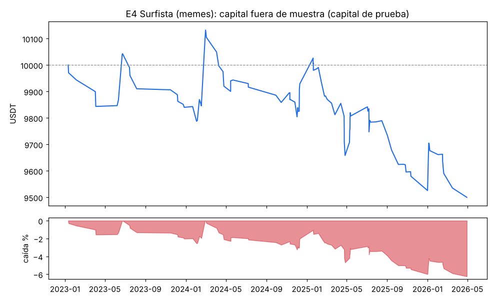
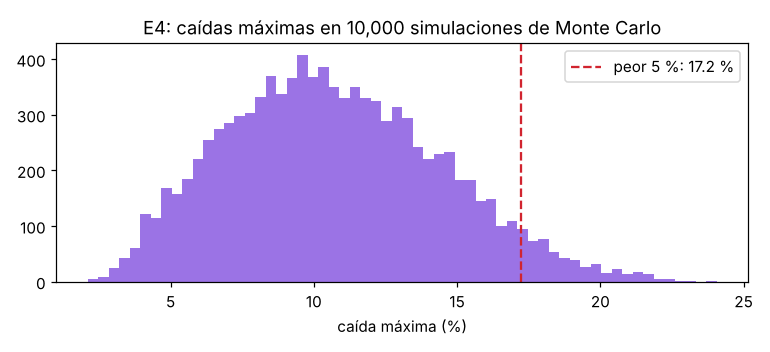
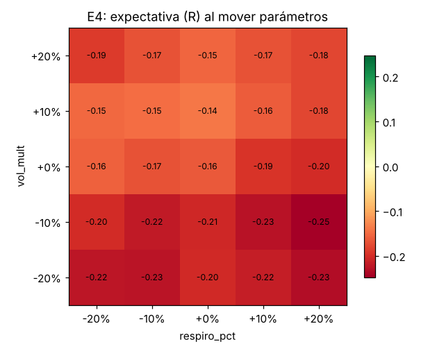

## E5 — Francotirador (cortos): ❌ NO PASA

Ronda de ajustes 1 de 3 · 18 combinaciones de parámetros probadas · parámetros finales: `{'donchian_n': 55, 'stop_atr': 3.0, 'chandelier_atr': 3.0, 'funding_min_pct': -0.05}`

**Compuertas:**

- ❌ 37 operaciones fuera de muestra (mínimo 100)
- ❌ factor de ganancia 0.54 (mínimo 1.3)
- ❌ expectativa -0.204R (mínimo +0.1R)
- ❌ 14 % de ventanas positivas (mínimo 60 %; contando solo las 9 ventanas con operaciones: 22 %)
- ✅ caída p95 de Monte Carlo 14.7 % (máximo 25 %)
- ❌ le gana al 4.8 % de las entradas al azar (mínimo 90.00 %)
- ✅ prueba final: 5 operaciones, expectativa +0.350R, factor 2.33
- ❌ robustez ±20 %: peor expectativa -0.068R

**Fuera de muestra (los 3 meses de prueba de cada ventana, unidos):**

| Número | Valor | Qué significa |
|---|---|---|
| Operaciones | 37 | cuántas veces entró |
| % ganadoras | 29.7 % | de cada 100 operaciones, cuántas ganaron |
| Ganancia promedio | +0.82R | lo que deja una ganadora en promedio |
| Pérdida promedio | -0.64R | lo que quita una perdedora en promedio |
| Expectativa | -0.204R | promedio por operación, ya con costos |
| Factor de ganancia | 0.54 | ganado ÷ perdido |
| Peor racha | 7 pérdidas seguidas | prepárate mentalmente para esto |
| Ventanas positivas | 14 % | en cuántos trimestres ganó |
| Rendimiento (capital de prueba) | -3.6 % | con 1 % de riesgo por operación |
| Caída máxima (capital de prueba) | 6.5 % | lo más que bajó desde un máximo |
| Comisiones | 4 % de la ganancia bruta | lo que se llevó Binance |

**Monte Carlo (10,000 simulaciones):** rendimiento entre -14.1 % y +0.4 % (90 % de los casos; mediana -7.6 %). Caída máxima típica 9.3 %, en el peor 5 % 14.7 %. Probabilidad de tocar −15 % (el freno total): 4.0 %. Racha perdedora típica 7, en el peor 5 % 14.

**Contra el azar:** con entradas al azar (mismas salidas, mismos filtros) la expectativa típica fue +0.020R; el 10 % mejor llegó a +0.229R. La estrategia le gana al 5 % de ellas.

**Contra comprar y aguantar BTC:** en el mismo periodo fuera de muestra BTC hizo +361.9 % con una caída de 50.1 %; la estrategia -3.6 % con caída de 6.5 %. En la prueba final BTC hizo +1.5 %.

**Por régimen de BTC al entrar:**

| Régimen | Operaciones | Expectativa | Factor de ganancia |
|---|---|---|---|
| BAJISTA | 37 | -0.204R | 0.54 |

**Prueba final intocable:** 5 operaciones, expectativa +0.350R, factor 2.33, rendimiento +1.6 %.

**Con tus 46.18 USDT reales:** de 876 señales que pasaron los demás filtros, se habrían ejecutado 21 y **229 se habrían saltado por falta de capital**.
Para no saltarse la mitad de esas, harían falta unos **91 USDT**; para no saltarse 3 de cada 4, unos 111 USDT.

**Robustez:** al mover donchian_n, stop_atr ±20 %, la peor expectativa fue -0.068R (negativa en todos los casos: no hay una zona de parámetros que funcione).

**Ventanas de walk-forward:**

| Prueba | Parámetros elegidos | Operaciones | Suma de R |
|---|---|---|---|
| 2023-01-01 a 2023-04-01 | `{'donchian_n': 40, 'stop_atr': 2.5, 'chandelier_atr': 4.0, 'funding_min_pct': -0.05}` | 1 | -1.08 |
| 2023-04-01 a 2023-07-01 | `{'donchian_n': 40, 'stop_atr': 2.5, 'chandelier_atr': 4.0, 'funding_min_pct': -0.05}` | 0 | +0.00 |
| 2023-07-01 a 2023-10-01 | `{'donchian_n': 20, 'stop_atr': 3.0, 'chandelier_atr': 3.0, 'funding_min_pct': -0.05}` | 5 | -2.52 |
| 2023-10-01 a 2024-01-01 | `{'donchian_n': 20, 'stop_atr': 3.0, 'chandelier_atr': 3.0, 'funding_min_pct': -0.05}` | 0 | +0.00 |
| 2024-01-01 a 2024-04-01 | `{'donchian_n': 20, 'stop_atr': 3.0, 'chandelier_atr': 3.0, 'funding_min_pct': -0.05}` | 1 | -0.85 |
| 2024-04-01 a 2024-07-01 | `{'donchian_n': 20, 'stop_atr': 3.0, 'chandelier_atr': 3.0, 'funding_min_pct': -0.05}` | 4 | -2.43 |
| 2024-07-01 a 2024-10-01 | `{'donchian_n': 40, 'stop_atr': 3.0, 'chandelier_atr': 4.0, 'funding_min_pct': -0.05}` | 4 | -0.32 |
| 2024-10-01 a 2025-01-01 | `{'donchian_n': 40, 'stop_atr': 3.0, 'chandelier_atr': 3.0, 'funding_min_pct': -0.05}` | 0 | +0.00 |
| 2025-01-01 a 2025-04-01 | `{'donchian_n': 40, 'stop_atr': 3.0, 'chandelier_atr': 3.0, 'funding_min_pct': -0.05}` | 4 | +1.47 |
| 2025-04-01 a 2025-07-01 | `{'donchian_n': 55, 'stop_atr': 3.0, 'chandelier_atr': 3.0, 'funding_min_pct': -0.05}` | 2 | -1.84 |
| 2025-07-01 a 2025-10-01 | `{'donchian_n': 55, 'stop_atr': 3.0, 'chandelier_atr': 3.0, 'funding_min_pct': -0.05}` | 0 | +0.00 |
| 2025-10-01 a 2026-01-01 | `{'donchian_n': 20, 'stop_atr': 3.0, 'chandelier_atr': 3.0, 'funding_min_pct': -0.05}` | 8 | +0.60 |
| 2026-01-01 a 2026-04-01 | `{'donchian_n': 20, 'stop_atr': 3.0, 'chandelier_atr': 3.0, 'funding_min_pct': -0.05}` | 8 | -0.58 |
| 2026-04-01 a 2026-05-01 | `{'donchian_n': 55, 'stop_atr': 3.0, 'chandelier_atr': 3.0, 'funding_min_pct': -0.05}` | 0 | +0.00 |

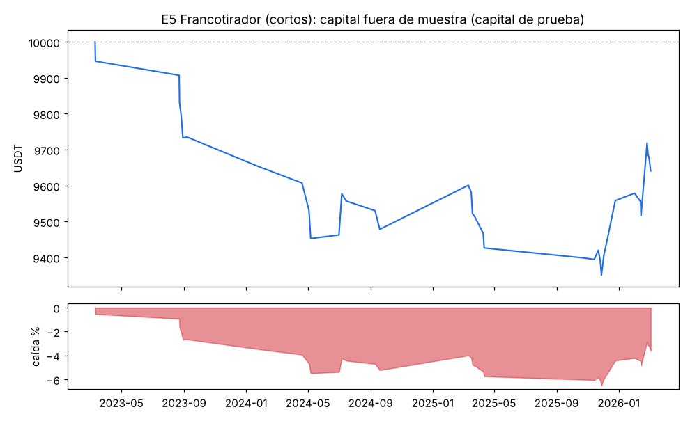
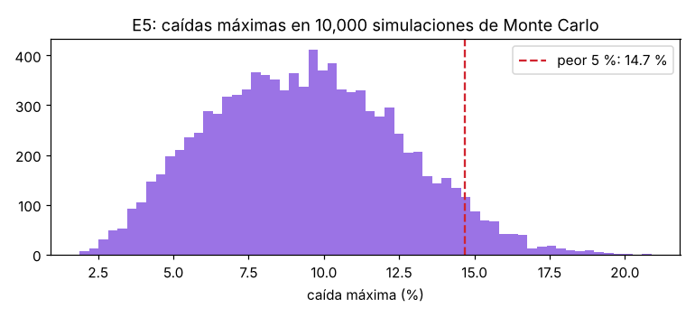
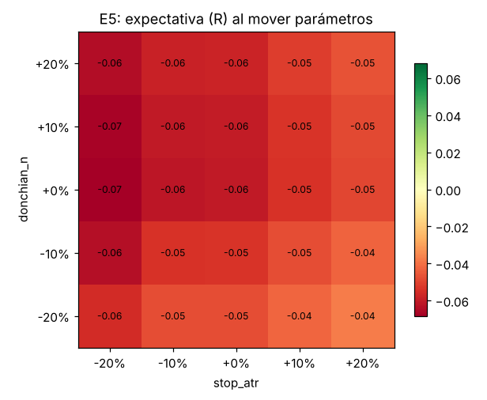

## Lo que estas pruebas NO pueden garantizar

- El pasado no garantiza el futuro. Los mercados cambian.
- Los resultados con 46 USDT pueden ser muy distintos a los del capital de prueba por los mínimos de Binance.
- El calendario de eventos (Fed, inflación) y los vetos de Noticias no existen en los datos del pasado: en vivo se saltarán algunas operaciones que el backtest sí tomó.
- Las reglas de Binance (mínimos y decimales) usadas son las actuales; en el pasado algunas eran distintas.
