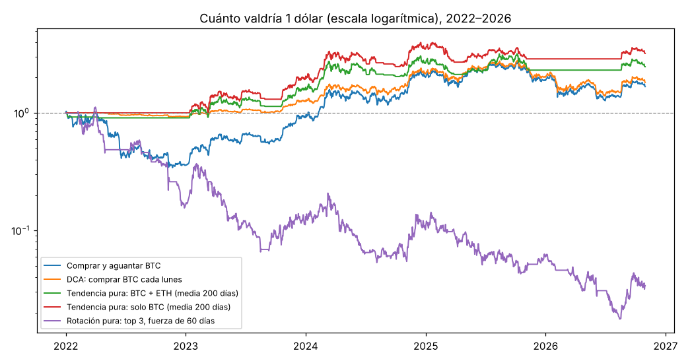
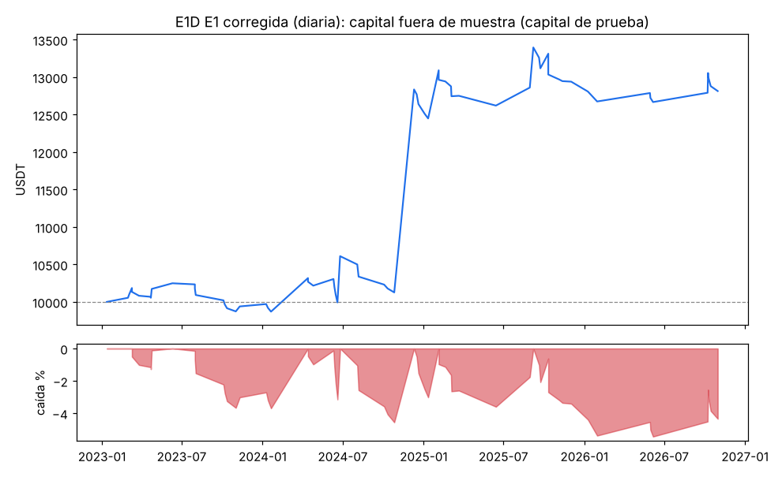
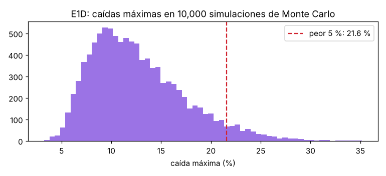
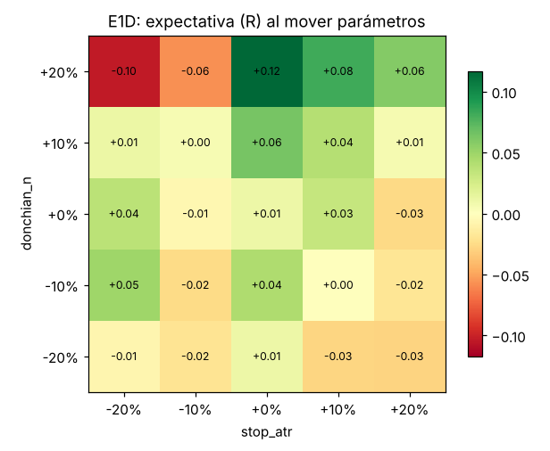
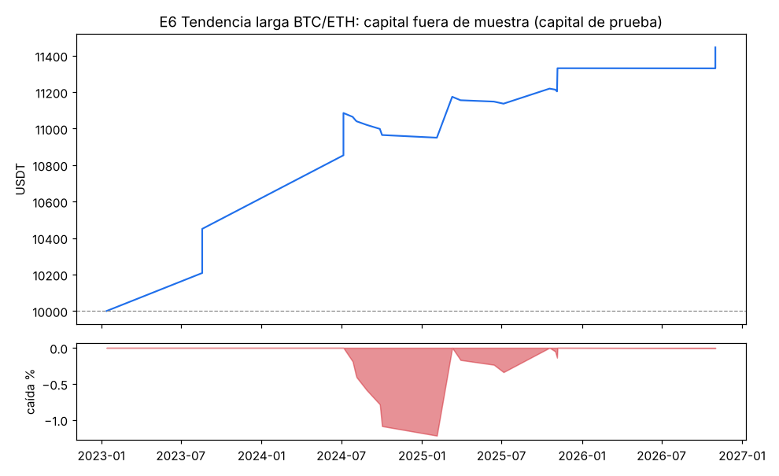
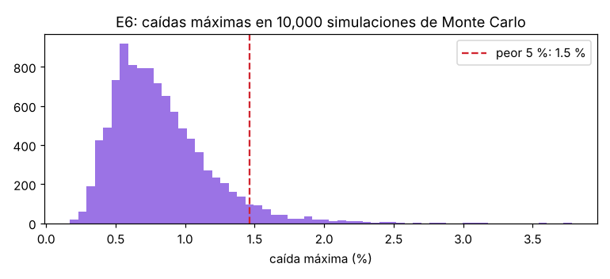
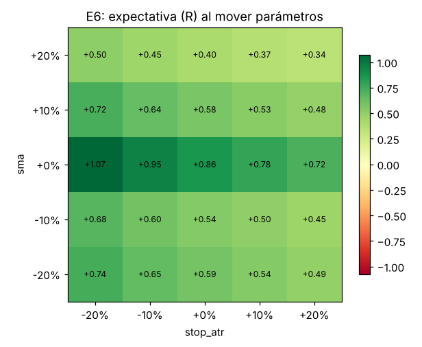
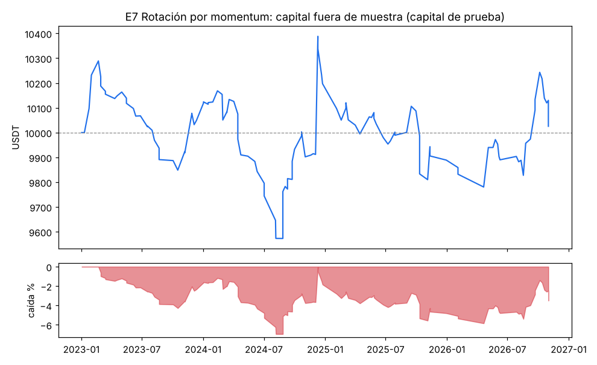
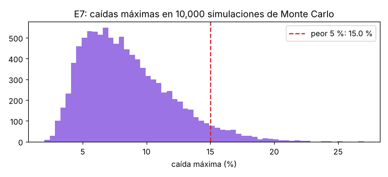
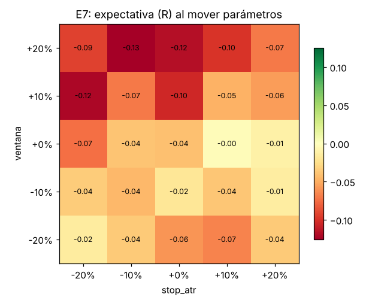

# VALIDACIÓN — RONDA 2

Generado el 10/11/2026 02:09 · reglamento 1.1.0 · datos de enero 2022 a octubre 2026.

## Resumen en una frase

**Ninguna estrategia de la ronda 2 pasó todas las compuertas con el motor de riesgo.** Abajo está qué tan cerca quedó cada una y cómo se comparan las ideas "puras" contra comprar y aguantar.

## Las reglas de esta ronda (escritas ANTES de ver resultados)

- Mismas compuertas y mismo motor de riesgo que la ronda 1.
- La prueba final de mayo–octubre 2026 ya se abrió en la ronda 1: ahora es una ventana más del walk-forward y además una compuerta extra (debe salir positiva). **Noviembre 2026 en adelante es la prueba en papel.**
- **Más estricto por probar muchas ideas** (8 en total con los mismos datos): debe ganarle al **98.75 %** de las entradas al azar (antes 90 %) y el **piso del intervalo de confianza del 99.4 %** de su expectativa debe ser mayor que cero. Esto baja la probabilidad de que un resultado bonito sea pura suerte.
- E6 y E7 se miden de dos formas: **pura** (todo el dinero adentro o afuera, como la idea original) y **con tu reglamento** (1 % de riesgo por operación, máximo 30 % por posición y 3 posiciones). Las compuertas se aplican a la versión con reglamento, porque es la que operaría.
- **Robustez** (cambio de método, avisado): se mide con las operaciones que el motor realmente toma. E6 y E7 repiten la señal cada día que siguen dentro; contar todas las señales mediría la misma posición muchas veces.
- **Corrección de datos** (afecta también a la ronda 1): 9 cambios de denominación de monedas (por ejemplo BNX 1:100 en febrero de 2023) aparecían como caídas falsas de hasta 99 %. Se ajustaron como un "split". La ronda 1 se volvió a correr.
- E1D cambia una regla del reglamento: no se sube el stop a la entrada en +1R (pedido por Ángelo; queda anotado en el reglamento 1.1.0).

## Veredicto con tu reglamento (compuertas)

| Estrategia | ¿Pasa? | Operaciones | Expectativa | Factor | Piso de confianza | Le gana al azar | Mayo–oct 2026 |
|---|---|---|---|---|---|---|---|
| E1D E1 corregida (diaria) | ❌ No | 66 | +0.539R | 1.88 | -0.394R | 95.7 % | +0.279R en 7 |
| E6 Tendencia larga BTC/ETH | ❌ No | 21 | +1.049R | 12.09 | +0.111R | 100.0 % | +0.502R en 2 |
| E7 Rotación por momentum | ❌ No | 122 | +0.015R | 1.06 | -0.151R | 87.2 % | +0.065R en 17 |

## Comparación de ideas puras: 2022-01 a 2026-10 (principal)

| Idea | Rendimiento total | Por año | Caída máxima | Volatilidad | Rend./volatilidad | Tiempo invertido |
|---|---|---|---|---|---|---|
| Comprar y aguantar BTC | +67 % | +11.3 % | 67 % | 50 % | 0.46 | 100 % |
| Comprar y aguantar 50 % BTC + 50 % ETH | +14 % | +2.8 % | 69 % | 54 % | 0.32 | 100 % |
| DCA: comprar BTC cada lunes | +82 % | +13.2 % | 50 % | 30 % | 0.56 | — |
| Tendencia pura: solo BTC (media 200 días) | +221 % | +27.3 % | 32 % | 33 % | 0.89 | 53 % |
| Tendencia pura: BTC + ETH (media 200 días) | +147 % | +20.6 % | 31 % | 33 % | 0.73 | 49 % |
| Rotación pura: top 3, fuerza de 30 días | -97 % | -50.9 % | 98 % | 88 % | -0.37 | 81 % |
| Rotación pura: top 3, fuerza de 60 días | -97 % | -50.4 % | 98 % | 90 % | -0.33 | 81 % |
| Rotación pura: top 3, fuerza de 90 días | -95 % | -46.1 % | 97 % | 88 % | -0.27 | 81 % |
| Rotación pura: top 5, fuerza de 30 días | -86 % | -33.3 % | 89 % | 77 % | -0.15 | 81 % |
| Rotación pura: top 5, fuerza de 60 días | -93 % | -41.7 % | 95 % | 79 % | -0.29 | 81 % |
| Rotación pura: top 5, fuerza de 90 días | -90 % | -37.8 % | 94 % | 77 % | -0.23 | 81 % |

## Comparación de ideas puras: 2018-01 a 2021-12 (antes, solo BTC/ETH)

| Idea | Rendimiento total | Por año | Caída máxima | Volatilidad | Rend./volatilidad | Tiempo invertido |
|---|---|---|---|---|---|---|
| Comprar y aguantar BTC | +244 % | +36.2 % | 81 % | 77 % | 0.79 | 100 % |
| Comprar y aguantar 50 % BTC + 50 % ETH | +325 % | +43.6 % | 88 % | 83 % | 0.86 | 100 % |
| DCA: comprar BTC cada lunes | +404 % | +49.9 % | 52 % | 49 % | 1.07 | — |
| Tendencia pura: solo BTC (media 200 días) | +118 % | +21.6 % | 64 % | 51 % | 0.64 | 51 % |
| Tendencia pura: BTC + ETH (media 200 días) | +261 % | +37.9 % | 61 % | 57 % | 0.85 | 54 % |

## Comparación de ideas puras: 2026-05 a 2026-10 (ya abierto)

| Idea | Rendimiento total | Por año | Caída máxima | Volatilidad | Rend./volatilidad | Tiempo invertido |
|---|---|---|---|---|---|---|
| Comprar y aguantar BTC | +1 % | +2.7 % | 29 % | 37 % | 0.25 | 100 % |
| Comprar y aguantar 50 % BTC + 50 % ETH | +0 % | +0.8 % | 31 % | 43 % | 0.23 | 100 % |
| DCA: comprar BTC cada lunes | +7 % | +14.8 % | 10 % | 22 % | 0.74 | — |
| Tendencia pura: solo BTC (media 200 días) | +11 % | +24.1 % | 11 % | 25 % | 0.99 | 40 % |
| Tendencia pura: BTC + ETH (media 200 días) | +5 % | +11.2 % | 15 % | 26 % | 0.54 | 40 % |
| Rotación pura: top 3, fuerza de 30 días | -27 % | -47.0 % | 59 % | 94 % | -0.20 | 85 % |
| Rotación pura: top 3, fuerza de 60 días | +2 % | +4.4 % | 61 % | 97 % | 0.53 | 85 % |
| Rotación pura: top 3, fuerza de 90 días | -21 % | -37.7 % | 59 % | 96 % | -0.01 | 85 % |
| Rotación pura: top 5, fuerza de 30 días | -8 % | -15.5 % | 41 % | 78 % | 0.17 | 85 % |
| Rotación pura: top 5, fuerza de 60 días | -13 % | -24.5 % | 53 % | 80 % | 0.05 | 85 % |
| Rotación pura: top 5, fuerza de 90 días | -2 % | -3.7 % | 47 % | 80 % | 0.36 | 85 % |

**Cómo leer estas tablas:** *caída máxima* es lo más que bajó tu dinero desde su punto más alto (lo que más duele). *Rend./volatilidad* compara la ganancia contra los sustos: más alto = más ganancia por cada susto. Las rotaciones se muestran TODAS (6 variantes) para que no se elija a la que le fue mejor por suerte.

## Rendimiento por año (versiones puras y referencias)

| Idea | 2022 | 2023 | 2024 | 2025 | 2026 |
|---|---|---|---|---|---|
| Comprar y aguantar BTC | -64 % | +154 % | +120 % | -5 % | -13 % |
| DCA: comprar BTC cada lunes | -7 % | +34 % | +72 % | -5 % | -11 % |
| Tendencia pura: solo BTC (media 200 días) | +0 % | +94 % | +81 % | -18 % | +11 % |
| Tendencia pura: BTC + ETH (media 200 días) | -9 % | +74 % | +68 % | -13 % | +7 % |
| Rotación pura: top 3, fuerza de 60 días | -84 % | -32 % | -10 % | -41 % | -43 % |
| Rotación pura: top 5, fuerza de 60 días | -79 % | +4 % | -1 % | -40 % | -44 % |

## E1D — E1 corregida (diaria): ❌ NO PASA

Ronda de ajustes 2 de 3 · 8 combinaciones de parámetros probadas · parámetros finales: `{'donchian_n': 20, 'stop_atr': 2.0, 'chandelier_atr': 4.0}`

**Compuertas:**

- ❌ 66 operaciones fuera de muestra (mínimo 100)
- ✅ factor de ganancia 1.88 (mínimo 1.3)
- ✅ expectativa +0.539R (mínimo +0.1R)
- ❌ 38 % de ventanas positivas (mínimo 60 %; contando solo las 16 ventanas con operaciones: 38 %)
- ✅ caída p95 de Monte Carlo 21.6 % (máximo 25 %)
- ❌ le gana al 95.7 % de las entradas al azar (mínimo 98.75 %)
- ✅ mayo–octubre 2026 (ya abierto, como una ventana más): 7 operaciones, expectativa +0.279R, factor 1.47
- ❌ piso del intervalo de confianza del 99.4 %: -0.394R (debe ser mayor que 0R)
- ❌ robustez ±20 %: peor expectativa -0.104R

**Fuera de muestra (los 3 meses de prueba de cada ventana, unidos):**

| Número | Valor | Qué significa |
|---|---|---|
| Operaciones | 66 | cuántas veces entró |
| % ganadoras | 28.8 % | de cada 100 operaciones, cuántas ganaron |
| Ganancia promedio | +4.01R | lo que deja una ganadora en promedio |
| Pérdida promedio | -0.86R | lo que quita una perdedora en promedio |
| Expectativa | +0.539R | promedio por operación, ya con costos |
| Factor de ganancia | 1.88 | ganado ÷ perdido |
| Peor racha | 7 pérdidas seguidas | prepárate mentalmente para esto |
| Ventanas positivas | 38 % | en cuántos trimestres ganó |
| Rendimiento (capital de prueba) | +28.1 % | con 1 % de riesgo por operación |
| Caída máxima (capital de prueba) | 5.4 % | lo más que bajó desde un máximo |
| Comisiones | 2 % de la ganancia bruta | lo que se llevó Binance |

**Monte Carlo (10,000 simulaciones):** rendimiento entre -11.6 % y +129.0 % (90 % de los casos; mediana +32.3 %). Caída máxima típica 11.8 %, en el peor 5 % 21.6 %. Probabilidad de tocar −15 % (el freno total): 26.7 %. Racha perdedora típica 9, en el peor 5 % 16.

**Contra el azar:** con entradas al azar (mismas salidas, mismos filtros) la expectativa típica fue -0.244R; el 10 % mejor llegó a +0.297R. La estrategia le gana al 96 % de ellas.

**Contra comprar y aguantar BTC:** en el mismo periodo fuera de muestra BTC hizo +369.4 % con una caída de 53.7 %; la estrategia +28.1 % con caída de 5.4 %. En la prueba final BTC hizo — %.

**Por régimen de BTC al entrar:**

| Régimen | Operaciones | Expectativa | Factor de ganancia |
|---|---|---|---|
| ALCISTA | 23 | +2.550R | 8.14 |
| LATERAL | 43 | -0.536R | 0.29 |

**Prueba final intocable:** 7 operaciones, expectativa +0.279R, factor 1.47, rendimiento — %.

**Con tus 46.18 USDT reales:** de 949 señales que pasaron los demás filtros, se habrían ejecutado 29 y **418 se habrían saltado por falta de capital**.
Para no saltarse la mitad de esas, harían falta unos **130 USDT**; para no saltarse 3 de cada 4, unos 197 USDT.

**Robustez:** al mover donchian_n, stop_atr ±20 %, la peor expectativa fue -0.104R (en algunos casos se vuelve negativa).

**Ventanas de walk-forward:**

| Prueba | Parámetros elegidos | Operaciones | Suma de R |
|---|---|---|---|
| 2023-01-01 a 2023-04-01 | `{'donchian_n': 20, 'stop_atr': 2.0, 'chandelier_atr': 4.0}` | 6 | +0.34 |
| 2023-04-01 a 2023-07-01 | `{'donchian_n': 55, 'stop_atr': 3.0, 'chandelier_atr': 4.0}` | 4 | +1.50 |
| 2023-07-01 a 2023-10-01 | `{'donchian_n': 55, 'stop_atr': 3.0, 'chandelier_atr': 4.0}` | 5 | -1.19 |
| 2023-10-01 a 2024-01-01 | `{'donchian_n': 20, 'stop_atr': 2.0, 'chandelier_atr': 6.0}` | 5 | +20.08 |
| 2024-01-01 a 2024-04-01 | `{'donchian_n': 55, 'stop_atr': 2.0, 'chandelier_atr': 6.0}` | 3 | -2.53 |
| 2024-04-01 a 2024-07-01 | `{'donchian_n': 20, 'stop_atr': 2.0, 'chandelier_atr': 6.0}` | 5 | -3.21 |
| 2024-07-01 a 2024-10-01 | `{'donchian_n': 20, 'stop_atr': 2.0, 'chandelier_atr': 6.0}` | 6 | +28.32 |
| 2024-10-01 a 2025-01-01 | `{'donchian_n': 20, 'stop_atr': 2.0, 'chandelier_atr': 6.0}` | 5 | -4.51 |
| 2025-01-01 a 2025-04-01 | `{'donchian_n': 20, 'stop_atr': 2.0, 'chandelier_atr': 6.0}` | 6 | -5.00 |
| 2025-04-01 a 2025-07-01 | `{'donchian_n': 20, 'stop_atr': 2.0, 'chandelier_atr': 6.0}` | 4 | +6.61 |
| 2025-07-01 a 2025-10-01 | `{'donchian_n': 20, 'stop_atr': 2.0, 'chandelier_atr': 6.0}` | 3 | -3.12 |
| 2025-10-01 a 2026-01-01 | `{'donchian_n': 20, 'stop_atr': 2.0, 'chandelier_atr': 6.0}` | 5 | -3.49 |
| 2026-01-01 a 2026-04-01 | `{'donchian_n': 55, 'stop_atr': 3.0, 'chandelier_atr': 6.0}` | 1 | -1.03 |
| 2026-04-01 a 2026-07-01 | `{'donchian_n': 55, 'stop_atr': 3.0, 'chandelier_atr': 6.0}` | 3 | -0.57 |
| 2026-07-01 a 2026-10-01 | `{'donchian_n': 55, 'stop_atr': 3.0, 'chandelier_atr': 4.0}` | 3 | +5.45 |
| 2026-10-01 a 2026-11-01 | `{'donchian_n': 20, 'stop_atr': 2.0, 'chandelier_atr': 4.0}` | 2 | -2.04 |

**Por año (con tu reglamento):** 2023: 20 op., +1.04R · 2024: 19 op., +0.95R · 2025: 18 op., -0.28R · 2026: 9 op., +0.20R

## E6 — Tendencia larga BTC/ETH: ❌ NO PASA

Ronda de ajustes 1 de 3 · 2 combinaciones de parámetros probadas · parámetros finales: `{'sma': 200, 'stop_atr': 5.0}`

**Compuertas:**

- ❌ 21 operaciones fuera de muestra (mínimo 100)
- ✅ factor de ganancia 12.09 (mínimo 1.3)
- ✅ expectativa +1.049R (mínimo +0.1R)
- ❌ 38 % de ventanas positivas (mínimo 60 %; contando solo las 9 ventanas con operaciones: 67 %)
- ✅ caída p95 de Monte Carlo 1.5 % (máximo 25 %)
- ✅ le gana al 100.0 % de las entradas al azar (mínimo 98.75 %)
- ✅ mayo–octubre 2026 (ya abierto, como una ventana más): 2 operaciones, expectativa +0.502R, factor 95.33
- ✅ piso del intervalo de confianza del 99.4 %: +0.111R (debe ser mayor que 0R)
- ✅ robustez ±20 %: peor expectativa +0.336R

**Fuera de muestra (los 3 meses de prueba de cada ventana, unidos):**

| Número | Valor | Qué significa |
|---|---|---|
| Operaciones | 21 | cuántas veces entró |
| % ganadoras | 38.1 % | de cada 100 operaciones, cuántas ganaron |
| Ganancia promedio | +3.00R | lo que deja una ganadora en promedio |
| Pérdida promedio | -0.15R | lo que quita una perdedora en promedio |
| Expectativa | +1.049R | promedio por operación, ya con costos |
| Factor de ganancia | 12.09 | ganado ÷ perdido |
| Peor racha | 7 pérdidas seguidas | prepárate mentalmente para esto |
| Ventanas positivas | 38 % | en cuántos trimestres ganó |
| Rendimiento (capital de prueba) | +14.5 % | con 1 % de riesgo por operación |
| Caída máxima (capital de prueba) | 1.2 % | lo más que bajó desde un máximo |
| Comisiones | 2 % de la ganancia bruta | lo que se llevó Binance |

**Monte Carlo (10,000 simulaciones):** rendimiento entre +7.7 % y +45.2 % (90 % de los casos; mediana +23.0 %). Caída máxima típica 0.8 %, en el peor 5 % 1.5 %. Probabilidad de tocar −15 % (el freno total): 0.0 %. Racha perdedora típica 5, en el peor 5 % 9.

**Contra el azar:** con entradas al azar (mismas salidas, mismos filtros) la expectativa típica fue -0.052R; el 10 % mejor llegó a +0.250R. La estrategia le gana al 100 % de ellas.

**Contra comprar y aguantar BTC:** en el mismo periodo fuera de muestra BTC hizo +369.4 % con una caída de 53.7 %; la estrategia +14.5 % con caída de 1.2 %. En la prueba final BTC hizo — %.

**Por régimen de BTC al entrar:**

| Régimen | Operaciones | Expectativa | Factor de ganancia |
|---|---|---|---|
| ALCISTA | 5 | +1.701R | 12.03 |
| LATERAL | 16 | +0.846R | 12.14 |

**Prueba final intocable:** 2 operaciones, expectativa +0.502R, factor 95.33, rendimiento — %.

**Con tus 46.18 USDT reales:** de 1705 señales que pasaron los demás filtros, se habrían ejecutado 1 y **1401 se habrían saltado por falta de capital**.
Para no saltarse la mitad de esas, harían falta unos **93 USDT**; para no saltarse 3 de cada 4, unos 129 USDT.

**Robustez:** al mover sma, stop_atr ±20 %, la peor expectativa fue +0.336R (sigue positiva en todos los casos).

**Ventanas de walk-forward:**

| Prueba | Parámetros elegidos | Operaciones | Suma de R |
|---|---|---|---|
| 2023-01-01 a 2023-04-01 | `{'sma': 200, 'stop_atr': 3.0}` | 2 | +6.92 |
| 2023-04-01 a 2023-07-01 | `{'sma': 200, 'stop_atr': 5.0}` | 0 | +0.00 |
| 2023-07-01 a 2023-10-01 | `{'sma': 200, 'stop_atr': 5.0}` | 0 | +0.00 |
| 2023-10-01 a 2024-01-01 | `{'sma': 200, 'stop_atr': 5.0}` | 2 | +12.16 |
| 2024-01-01 a 2024-04-01 | `{'sma': 200, 'stop_atr': 3.0}` | 0 | +0.00 |
| 2024-04-01 a 2024-07-01 | `{'sma': 200, 'stop_atr': 3.0}` | 0 | +0.00 |
| 2024-07-01 a 2024-10-01 | `{'sma': 200, 'stop_atr': 3.0}` | 6 | -1.09 |
| 2024-10-01 a 2025-01-01 | `{'sma': 200, 'stop_atr': 3.0}` | 2 | +1.78 |
| 2025-01-01 a 2025-04-01 | `{'sma': 200, 'stop_atr': 3.0}` | 1 | -0.17 |
| 2025-04-01 a 2025-07-01 | `{'sma': 200, 'stop_atr': 5.0}` | 2 | +0.68 |
| 2025-07-01 a 2025-10-01 | `{'sma': 200, 'stop_atr': 5.0}` | 2 | +1.04 |
| 2025-10-01 a 2026-01-01 | `{'sma': 200, 'stop_atr': 5.0}` | 2 | -0.28 |
| 2026-01-01 a 2026-04-01 | `{'sma': 200, 'stop_atr': 5.0}` | 0 | +0.00 |
| 2026-04-01 a 2026-07-01 | `{'sma': 200, 'stop_atr': 5.0}` | 0 | +0.00 |
| 2026-07-01 a 2026-10-01 | `{'sma': 200, 'stop_atr': 5.0}` | 2 | +1.00 |
| 2026-10-01 a 2026-11-01 | `{'sma': 200, 'stop_atr': 5.0}` | 0 | +0.00 |

**Por año (con tu reglamento):** 2023: 4 op., +4.77R · 2024: 8 op., +0.09R · 2025: 7 op., +0.18R · 2026: 2 op., +0.50R

## E7 — Rotación por momentum: ❌ NO PASA

Ronda de ajustes 1 de 3 · 6 combinaciones de parámetros probadas · parámetros finales: `{'ventana': 30, 'stop_atr': 3.0}`

**Compuertas:**

- ✅ 122 operaciones fuera de muestra (mínimo 100)
- ❌ factor de ganancia 1.06 (mínimo 1.3)
- ❌ expectativa +0.015R (mínimo +0.1R)
- ❌ 38 % de ventanas positivas (mínimo 60 %; contando solo las 16 ventanas con operaciones: 38 %)
- ✅ caída p95 de Monte Carlo 15.0 % (máximo 25 %)
- ❌ le gana al 87.2 % de las entradas al azar (mínimo 98.75 %)
- ✅ mayo–octubre 2026 (ya abierto, como una ventana más): 17 operaciones, expectativa +0.065R, factor 1.22
- ❌ piso del intervalo de confianza del 99.4 %: -0.151R (debe ser mayor que 0R)
- ❌ robustez ±20 %: peor expectativa -0.125R

**Fuera de muestra (los 3 meses de prueba de cada ventana, unidos):**

| Número | Valor | Qué significa |
|---|---|---|
| Operaciones | 122 | cuántas veces entró |
| % ganadoras | 39.3 % | de cada 100 operaciones, cuántas ganaron |
| Ganancia promedio | +0.68R | lo que deja una ganadora en promedio |
| Pérdida promedio | -0.42R | lo que quita una perdedora en promedio |
| Expectativa | +0.015R | promedio por operación, ya con costos |
| Factor de ganancia | 1.06 | ganado ÷ perdido |
| Peor racha | 13 pérdidas seguidas | prepárate mentalmente para esto |
| Ventanas positivas | 38 % | en cuántos trimestres ganó |
| Rendimiento (capital de prueba) | +0.3 % | con 1 % de riesgo por operación |
| Caída máxima (capital de prueba) | 7.0 % | lo más que bajó desde un máximo |
| Comisiones | 2 % de la ganancia bruta | lo que se llevó Binance |

**Monte Carlo (10,000 simulaciones):** rendimiento entre -11.7 % y +17.2 % (90 % de los casos; mediana +1.0 %). Caída máxima típica 7.9 %, en el peor 5 % 15.0 %. Probabilidad de tocar −15 % (el freno total): 5.1 %. Racha perdedora típica 8, en el peor 5 % 13.

**Contra el azar:** con entradas al azar (mismas salidas, mismos filtros) la expectativa típica fue -0.024R; el 10 % mejor llegó a +0.021R. La estrategia le gana al 87 % de ellas.

**Contra comprar y aguantar BTC:** en el mismo periodo fuera de muestra BTC hizo +369.4 % con una caída de 53.7 %; la estrategia +0.3 % con caída de 7.0 %. En la prueba final BTC hizo — %.

**Por régimen de BTC al entrar:**

| Régimen | Operaciones | Expectativa | Factor de ganancia |
|---|---|---|---|
| ALCISTA | 44 | -0.056R | 0.80 |
| LATERAL | 78 | +0.055R | 1.23 |

**Prueba final intocable:** 17 operaciones, expectativa +0.065R, factor 1.22, rendimiento — %.

**Con tus 46.18 USDT reales:** de 525 señales que pasaron los demás filtros, se habrían ejecutado 3 y **490 se habrían saltado por falta de capital**.
Para no saltarse la mitad de esas, harían falta unos **398 USDT**; para no saltarse 3 de cada 4, unos 765 USDT.

**Robustez:** al mover ventana, stop_atr ±20 %, la peor expectativa fue -0.125R (negativa en todos los casos: no hay una zona de parámetros que funcione).

**Ventanas de walk-forward:**

| Prueba | Parámetros elegidos | Operaciones | Suma de R |
|---|---|---|---|
| 2023-01-01 a 2023-04-01 | `{'ventana': 90, 'stop_atr': 5.0}` | 11 | +1.83 |
| 2023-04-01 a 2023-07-01 | `{'ventana': 90, 'stop_atr': 5.0}` | 6 | -0.99 |
| 2023-07-01 a 2023-10-01 | `{'ventana': 90, 'stop_atr': 5.0}` | 9 | -0.48 |
| 2023-10-01 a 2024-01-01 | `{'ventana': 30, 'stop_atr': 5.0}` | 8 | +1.84 |
| 2024-01-01 a 2024-04-01 | `{'ventana': 90, 'stop_atr': 3.0}` | 11 | -1.50 |
| 2024-04-01 a 2024-07-01 | `{'ventana': 90, 'stop_atr': 5.0}` | 7 | -2.30 |
| 2024-07-01 a 2024-10-01 | `{'ventana': 30, 'stop_atr': 5.0}` | 12 | +2.67 |
| 2024-10-01 a 2025-01-01 | `{'ventana': 90, 'stop_atr': 3.0}` | 10 | +1.43 |
| 2025-01-01 a 2025-04-01 | `{'ventana': 90, 'stop_atr': 5.0}` | 6 | -0.81 |
| 2025-04-01 a 2025-07-01 | `{'ventana': 90, 'stop_atr': 5.0}` | 7 | -0.37 |
| 2025-07-01 a 2025-10-01 | `{'ventana': 90, 'stop_atr': 5.0}` | 7 | -1.04 |
| 2025-10-01 a 2026-01-01 | `{'ventana': 90, 'stop_atr': 5.0}` | 7 | -1.02 |
| 2026-01-01 a 2026-04-01 | `{'ventana': 90, 'stop_atr': 5.0}` | 3 | +1.10 |
| 2026-04-01 a 2026-07-01 | `{'ventana': 60, 'stop_atr': 5.0}` | 4 | -1.32 |
| 2026-07-01 a 2026-10-01 | `{'ventana': 30, 'stop_atr': 5.0}` | 11 | +4.56 |
| 2026-10-01 a 2026-11-01 | `{'ventana': 30, 'stop_atr': 3.0}` | 3 | -1.81 |

**Por año (con tu reglamento):** 2023: 34 op., +0.06R · 2024: 40 op., +0.01R · 2025: 27 op., -0.12R · 2026: 21 op., +0.12R

